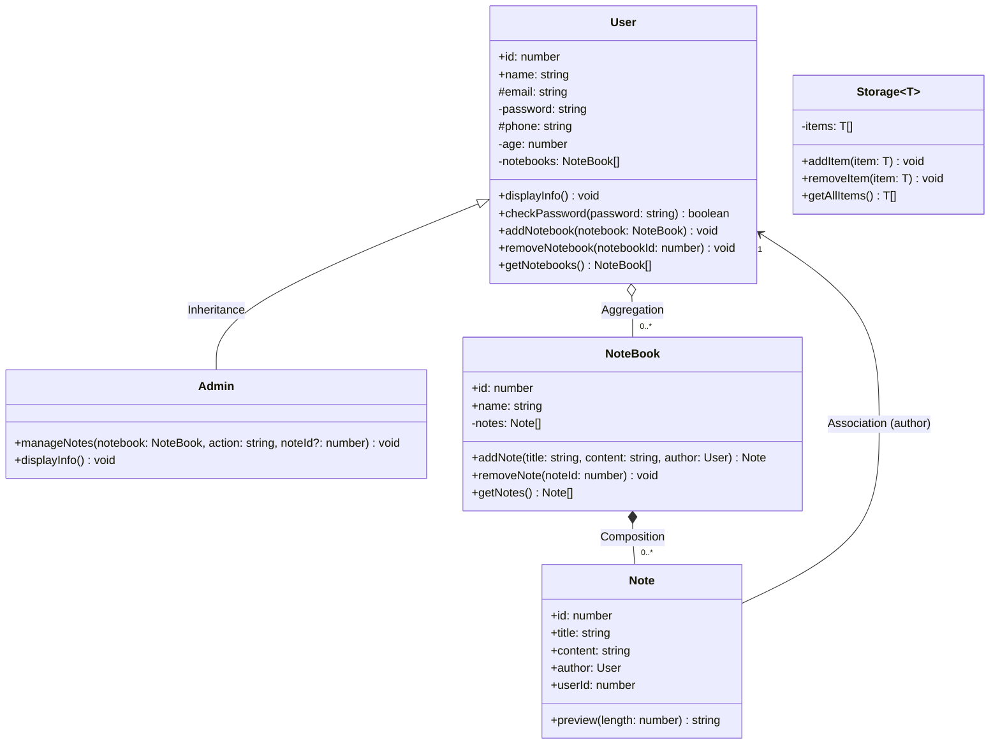

# Part B – UML Class Diagram

> Visibility: `+` public · `-` private · `#` protected

## Relationships

| Relationship | Between | UML symbol | Explanation |
|---|---|---|---|
| **Inheritance** | `Admin` → `User` | Hollow triangle arrow (`<|--`) | `Admin` **is a** `User`; it inherits all properties and methods and adds `manageNotes()`. |
| **Composition** | `NoteBook` ◆— `Note` | Filled diamond on NoteBook side | Notes are created **inside** the notebook (`addNote()` makes the `Note`). A note cannot exist without its notebook — if the notebook is deleted, its notes are deleted too. |
| **Aggregation** | `User` ◇— `NoteBook` | Hollow diamond on User side | A user **has** many notebooks, but notebooks are created separately and passed in with `addNotebook()`, so they can exist independently of the user. |
| **Association** | `Note` → `User` | Plain arrow | Each note **knows** its author (`author: User`). Both objects live independently; the note just references the user. |

`Storage<T>` is a standalone **generic class** – it has no relationship with the other classes but can store any of them (e.g. `Storage<User>`, `Storage<Note>`, `Storage<number>`).
